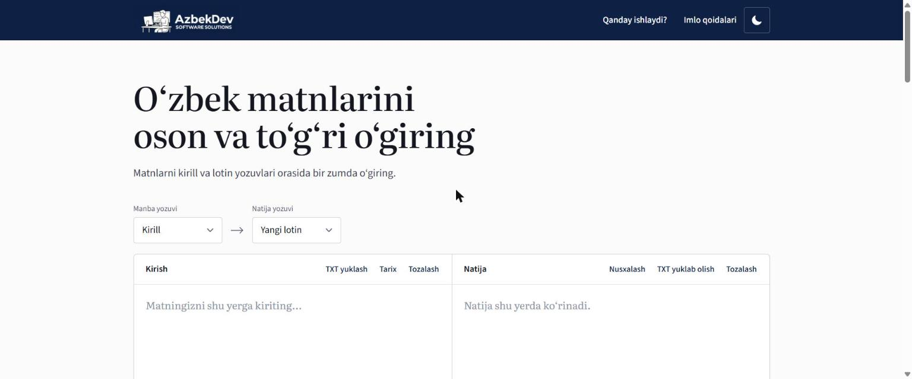

# O‘zbek matn o‘giruvchi

🔗 **Jonli demo: [newalifbo.netlify.app](https://newalifbo.netlify.app/)**



Kirill ↔ lotin o‘girish. Hammasi brauzerda ishlaydi: oddiy HTML/CSS/JS, server kerak emas.

## Ishga tushirish

```bash
npm install
npm start                 # http://localhost:3000 (oddiy statik server)
npm test                  # dvigatel testlari
```

Node.js 20 yoki undan yangisi kerak.

## Papkalar

| Yo‘l | Vazifasi |
| --- | --- |
| `public/js/converter.js` | Yozuv o‘girish dvigateli. UI’ga bog‘liq emas. |
| `public/js/app.js` | Interfeys mantig‘i |
| `public/js/theme.js` | Kunduzgi/tungi rejim (sahifa chizilishidan oldin ishlaydi) |
| `public/css/style.css` | Dizayn |
| `public/assets/logo.jpg` | Sizning logotipingiz (o‘zgartirilmagan nusxa) |
| `server.js` | Lokal sinov uchun oddiy statik server |
| `tests/` | Dvigatel va server testlari |

## Alifbo qoidalari

Dvigatel uch yozuvni biladi: kirill, **hozirgi lotin** (Oʻ, Gʻ, Sh, Ch) va **yangi lotin** (Ö, Ğ, Ş, Ç).

Yangi alifbo O‘RQ-1184-son qonunga (2026-yil 21-oktabr) asoslangan: https://lex.uz/docs/8548754. Qonun 2027-yil 22-apreldan kuchga kiradi, shu sanagacha hozirgi alifbo amalda.

Qonun alifbo jadvalini beradi, lekin ye/yo/yu/ya, ц va ъ/ь kabi holatlar uchun alohida qoida bermaydi. Ular uchun amaldagi imlo qoidalari qo‘llangan. Qoidalarni o‘zgartirish kerak bo‘lsa, faqat `public/js/converter.js` ichidagi jadvallar va funksiyalarni tahrirlang va `npm test` ni ishga tushiring.

Unicode: `Oʻ`/`Gʻ` uchun U+02BB, tutuq belgisi uchun U+02BC ishlatiladi.

## Joylashtirish

Sayt to‘liq statik: `public/` papkasini istalgan statik hostingga (Netlify, GitHub Pages va h.k.) joylashtirish kifoya. Netlify uchun `netlify.toml` tayyor: `npx netlify-cli deploy --prod --dir=public --site <SITE_ID>`.

## Tungi rejim

Sarlavhadagi tugma rejimni almashtiradi. Tanlov brauzerda saqlanadi; tanlanmagan bo‘lsa, qurilma sozlamasiga ergashadi. Ranglar `public/css/style.css` boshidagi `:root` va `:root[data-theme="dark"]` bloklarida.

## Maxfiylik

O‘girish to‘liq brauzerda bajariladi, matn hech qayerga yuborilmaydi. O‘girishlar tarixi faqat foydalanuvchining brauzerida (`localStorage`) saqlanadi.
